<div align="center">

# MLForge

### Machine learning from scratch - in pure NumPy, and *proven correct*.

[](https://github.com/your-username/mlforge/actions/workflows/ci.yml)
[](docs/correctness.md)
[](docs/correctness.md)
[](docs/correctness.md)
[](docs/mutation_survivors.md)
[](pyproject.toml)
[](LICENSE)
[](requirements.txt)

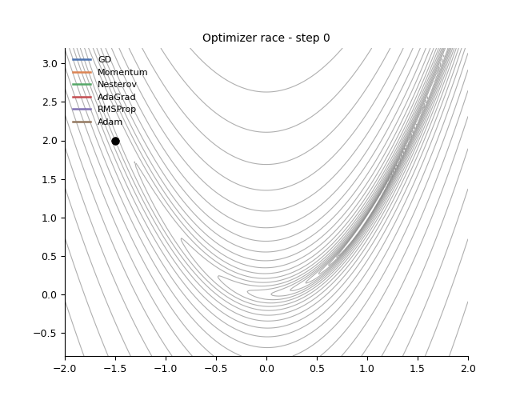 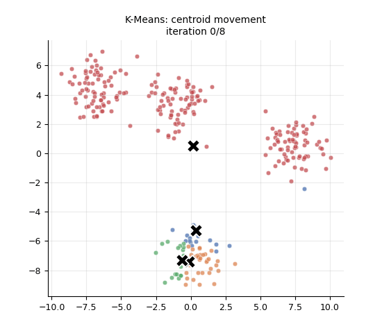

</div>

MLForge is a library **and** a research-style project: 40 estimators and a small deep-learning stack implemented from first principles with nothing but NumPy,
each with a written mathematical derivation, complexity analysis, tests, and a benchmark against its scikit-learn counterpart.

Most "from scratch" repositories stop at a working `fit` / `predict`. MLForge is built around one question - **how do you know the implementation is correct?** - and answers it with machinery you can run yourself.

## What makes it different

| | |
|---|---|
| **Gradients are verified, not trusted** | Every gradient-based model (linear / logistic / softmax regression, SVM, neural networks) is checked against central finite differences. `mlforge.utils.check_gradient` is public so you can check yours too. |
| **Reference parity is a test, not a claim** | Ridge, Lasso, ElasticNet, PCA, KNN, Naive Bayes, K-Means, hierarchical clustering, SVC and Newton-logistic agree with scikit-learn at tolerances between 1e-15 and 1e-6 - enforced in CI. Where randomness or tie-breaking makes bit-equality meaningless, tests assert the right structural invariant (leaf counts, neighbour *distances*, adjusted Rand index). |
| **Tests that are themselves tested** | 402 tests incl. 21 property-based laws (Hypothesis) found two real bugs; **mutation testing** (207/220 sampled mutants killed, 94%) found 30+ test gaps, all closed; every remaining survivor is reviewed ([notes](docs/mutation_survivors.md)). The [correctness dashboard](docs/correctness.md) regenerates all of it. |
| **Real-scale result, reproducible** | A 5,258-parameter CNN trained from scratch in NumPy reaches **98.57% on the real MNIST test set** (~97 s on one CPU core); data are SHA-256 verified and saved weights re-evaluate to the identical accuracy. |
| **Its own autograd engine** | `mlforge.autograd.Tensor` is a ~200-line reverse-mode automatic differentiation engine. A network is trained on XOR with *zero* hand-written backprop (`examples/autograd_neural_net_example.py`). |
| **Every optimizer plugs into every model** | GD / mini-batch / SGD, Momentum, Nesterov, AdaGrad, RMSProp, Adam, plus learning-rate schedules: `LogisticRegression(optimizer="adam")`, `MLPClassifier(optimizer="rmsprop")`, ... |
| **Real algorithms, not toy versions** | CART with vectorised split search and cost-complexity pruning, histogram gradient boosting (up to 12.6x faster than exact boosting at 32k rows), im2col convolutions with BPTT-capable LSTM, Platt's SMO for kernel SVMs, Lasso by coordinate descent *and* proximal gradient, Newton / IRLS logistic regression, K-Means++ with restarts, EM Gaussian mixtures, gradient boosting with Newton leaf updates. |
| **A complete workflow, not just models** | `Pipeline`, `GridSearchCV`, `RandomizedSearchCV`, stratified K-fold, learning / validation curves, scalers, encoders, imputers (incl. KNN) and 32 metrics. |
| **Built to be read** | Consistent `fit` / `predict` API, input validation with helpful errors, `NotFittedError`, `clone` / `get_params` / `save` / `load`. |
| **Reproducible evidence** | `python -m mlforge benchmark` regenerates a 29-algorithm comparison (time, memory, quality, numerical difference). |

## Gallery

<table>
<tr><td colspan="2">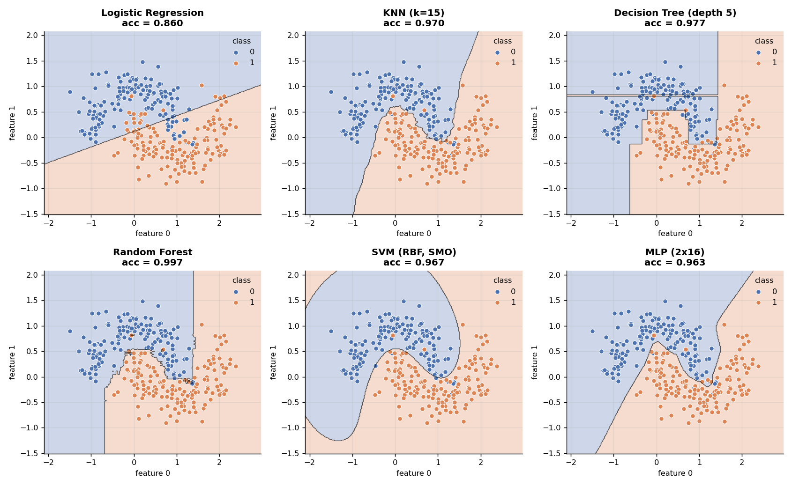</td></tr>
<tr><td>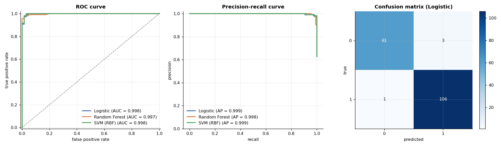</td><td>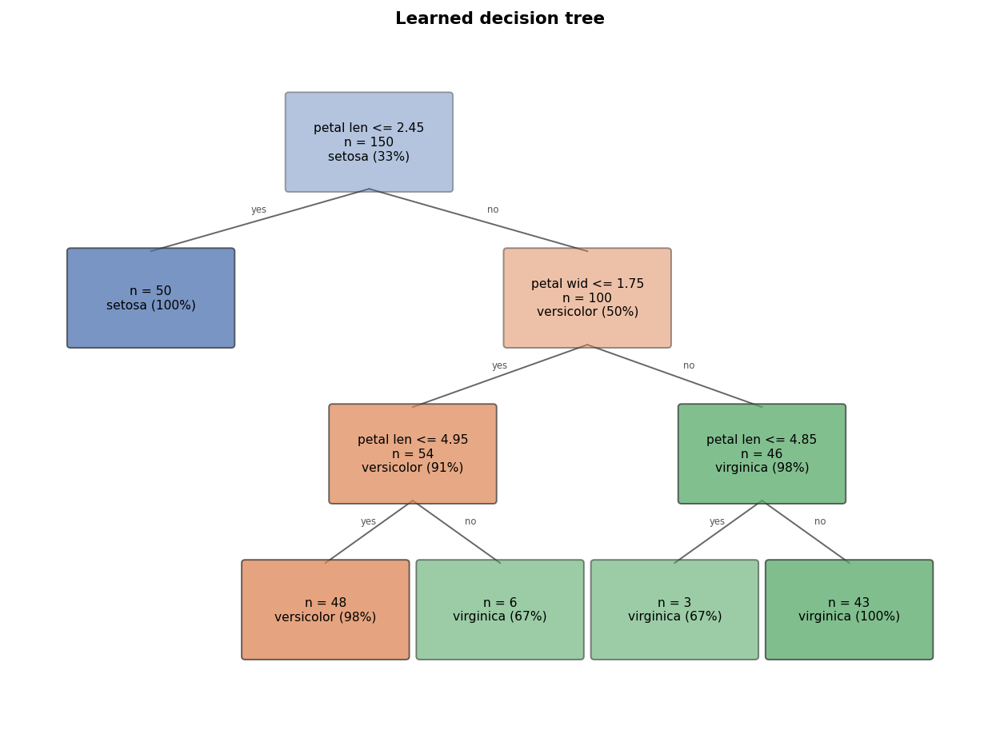</td></tr>
<tr><td>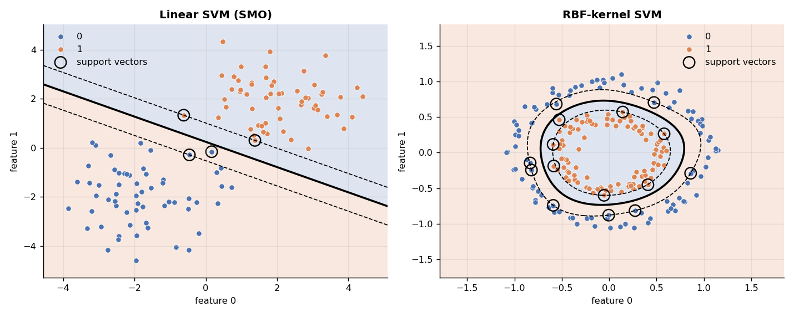</td><td>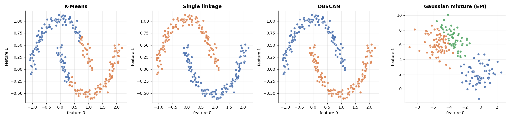</td></tr>
<tr><td>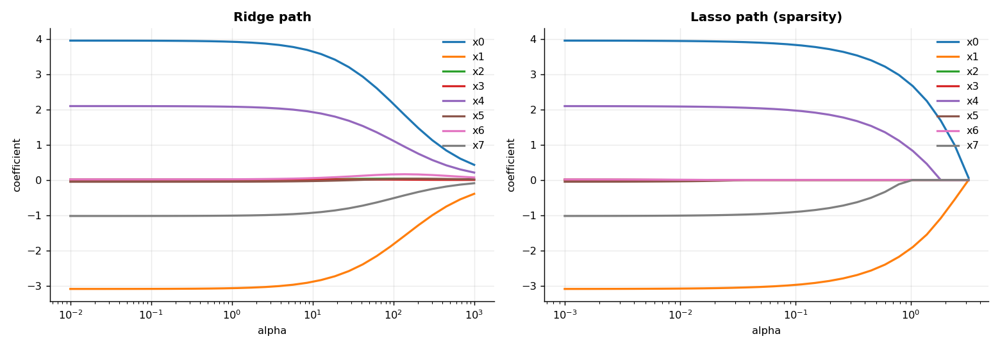</td><td>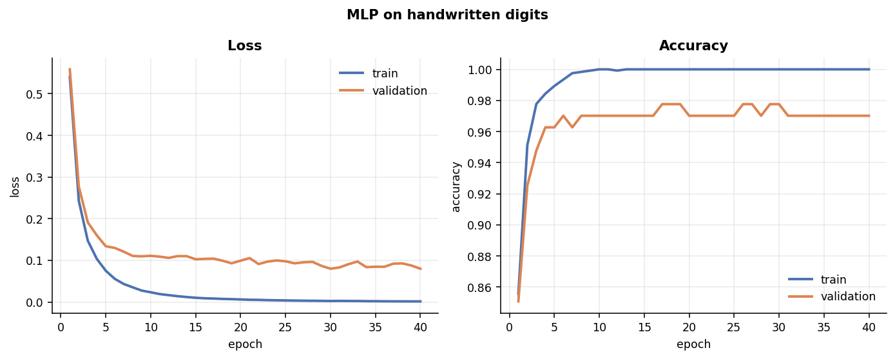</td></tr>
<tr><td>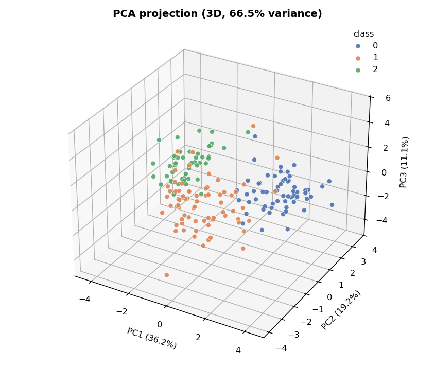</td><td>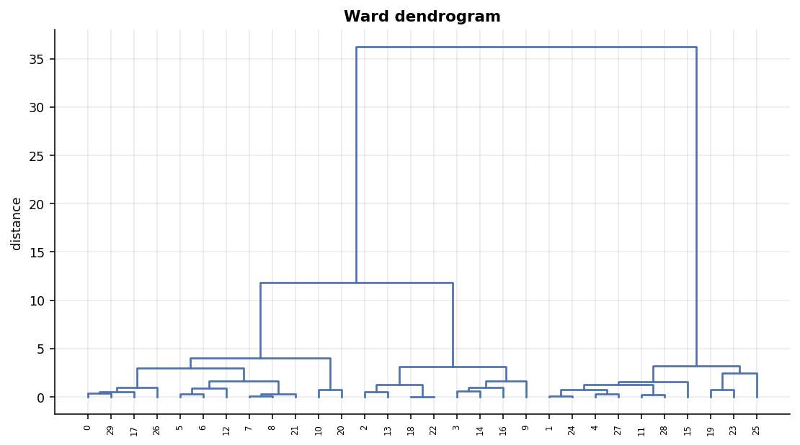</td></tr>
<tr><td colspan="2">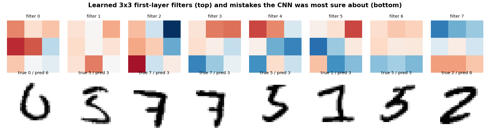</td></tr>
<tr><td colspan="2">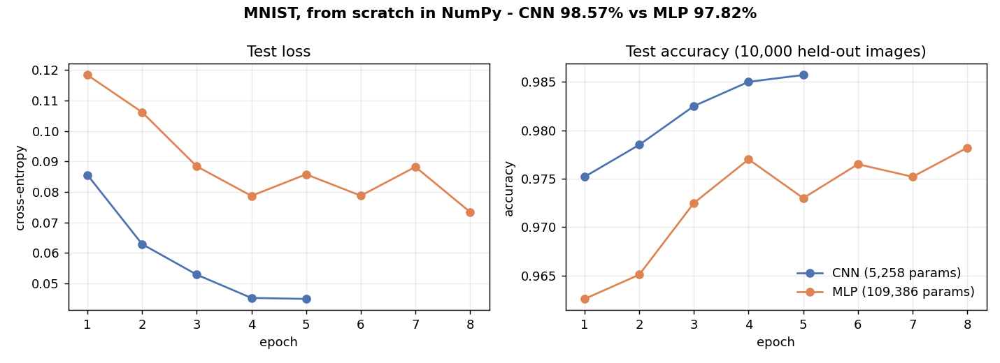</td></tr>
</table>

Every image is regenerated by `python examples/make_gallery.py`.

## Install

```bash
git clone https://github.com/your-username/mlforge.git && cd mlforge
pip install -e .              # NumPy only
pip install -e ".[viz]"       # + matplotlib plotting
pip install -e ".[dev]"       # + tests, benchmarks, notebooks, linting
```

> **Publishing note:** `mlforge` is already taken on PyPI by an unrelated project that also installs a top-level `mlforge` module. See [`docs/RELEASING.md`](docs/RELEASING.md); `python scripts/rename_package.py <name>` renames the import package (verified: the full test-suite passes under a renamed copy).

## Quickstart

```python
from mlforge import Pipeline
from mlforge.datasets import make_moons
from mlforge.model_selection import GridSearchCV, train_test_split
from mlforge.preprocessing import StandardScaler
from mlforge.svm import SVC
from mlforge.metrics import classification_report

X, y = make_moons(400, noise=0.3, random_state=0)
Xtr, Xte, ytr, yte = train_test_split(X, y, test_size=0.25, stratify=y, random_state=0)

pipe = Pipeline([("scale", StandardScaler()), ("svm", SVC())])           # kernel SVM trained with SMO
search = GridSearchCV(pipe, {"svm__C": [0.1, 1, 10], "svm__gamma": [0.1, 0.5, 2]}, cv=5).fit(Xtr, ytr)

print(search.best_params_, search.score(Xte, yte))
print(classification_report(yte, search.predict(Xte)))
```

Plug any optimizer into any model, and inspect training:

```python
from mlforge.linear_model import LogisticRegression
from mlforge.optimization import Adam, CosineAnnealing

clf = LogisticRegression(optimizer=Adam(0.05, schedule=CosineAnnealing(500)), C=1.0, n_iters=500, batch_size=64).fit(X, y)
clf.cost_history_           # loss per epoch
```

Check your own gradients:

```python
from mlforge.utils import check_gradient
ok, relative_error = check_gradient(loss_fn, grad_fn, theta)      # -> (True, 3e-10)
```

Automatic differentiation:

```python
from mlforge.autograd import Tensor
x = Tensor([2.0, 3.0], requires_grad=True)
((x * x).sum() + x.exp().sum()).backward()
x.grad                      # [11.389, 26.086]  =  2x + e^x
```

Command line:

```bash
python -m mlforge info                 # list all estimators
python -m mlforge demo                 # train + evaluate a few models
python -m mlforge benchmark --quick    # compare with scikit-learn
```

## What is implemented

| Module | Contents |
|---|---|
| `linear_model` | Linear (closed-form / GD), Polynomial, Ridge, Lasso, ElasticNet (coordinate descent + ISTA), Logistic (GD / Newton), Softmax, Perceptron |
| `tree` | Decision tree (classifier / regressor, Gini / entropy, cost-complexity pruning), Random forest (OOB score), exact **and histogram** gradient boosting (regressor / classifier) |
| `svm` | `LinearSVC` (hinge / squared hinge), kernel `SVC` via SMO (linear, poly, RBF, sigmoid, custom; one-vs-one multiclass) |
| `neural_network` | `Sequential`, `Dense`, **`Conv2D`, `MaxPool2D`, `Flatten`, `LSTM`**, ReLU / LeakyReLU / Sigmoid / Tanh / Softmax, `Dropout`, 3 losses, `MLPClassifier`, `MLPRegressor` (L2, early stopping, 4 initialisations) |
| `neighbors` | k-NN classifier / regressor, 5 distance metrics, distance weighting, deterministic ties |
| `cluster` | K-Means (++ / random, restarts), agglomerative (single / complete / average / Ward, SciPy-compatible linkage), DBSCAN, Gaussian mixture (EM, BIC / AIC), elbow & silhouette curves |
| `decomposition` | PCA (SVD / eigh, whitening, variance-target `n_components`) |
| `bayes` | Gaussian, Multinomial, Bernoulli Naive Bayes |
| `optimization` | GD, SGD, Momentum, Nesterov, AdaGrad, RMSProp, Adam, 5 LR schedules, test surfaces |
| `autograd` | Reverse-mode `Tensor` with broadcasting, matmul, reductions, activations |
| `datasets` | NumPy-only generators (blobs, moons, circles, spirals, ...) and `load_mnist` (checksum-verified download + cache) |
| `preprocessing` | Standard / MinMax / MaxAbs / Robust scalers, Normalizer, PolynomialFeatures, One-hot / Ordinal / Label encoders, Simple / KNN imputers |
| `model_selection` | stratified train/test split, KFold, StratifiedKFold, ShuffleSplit, `cross_val_score`, `GridSearchCV`, `RandomizedSearchCV`, learning & validation curves |
| `metrics` | 32 functions: accuracy, precision / recall / F-beta (macro / micro / weighted), ROC / AUC, PR / AP, log loss, MCC, kappa, MAE / MSE / RMSE / R2 / MAPE, silhouette, Davies-Bouldin, Calinski-Harabasz, ARI, NMI |
| `visualization` | 25 plot / animation functions: decision boundaries, ROC / PR, confusion matrix, learning curves, PCA 2-D / 3-D, trees, dendrograms, SVM margins, optimizer races, **animated GIFs** |

## Verification: how do you know it is correct?

1. **Numerical gradient checks** (`tests/test_gradients.py`, `test_conv_recurrent.py`): analytic vs finite-difference gradients for every loss, whole neural networks, convolutions (stride / padding variants), pooling and the LSTM; 13 re-computed on every dashboard run, worst relative error 8.8e-10. The suite also confirms the checker *detects* a wrong gradient.
2. **Reference parity** (`tests/test_sklearn_parity.py`):

   | Algorithm | Agreement with scikit-learn / SciPy (test tolerance) |
   |---|---|
   | OLS, Ridge | 1e-10 |
   | Lasso, ElasticNet | 1e-6 |
   | PCA (SVD and eigh) | variances 1e-9 (relative) |
   | k-NN, Naive Bayes (3 variants) | probabilities 1e-9 |
   | Newton logistic regression | probabilities 1e-6 |
   | Decision-tree structure | identical leaf count and depth across 12 settings |
   | Hierarchical clustering | ARI = 1.0; heights equal SciPy to 1e-10 |
   | Kernel SVM | >= 97% identical predictions, essentially the same support-vector count |
   | Metrics | 1e-9 |
3. **Mathematical invariants**: EM never decreases the likelihood; SMO output satisfies the dual constraints; PCA components are orthonormal and scores decorrelated; K-Means inertia is monotone; CV folds partition the data.
4. **Hand-computed examples**, **edge cases** (NaN, wrong shapes, unseen categories, constant features, single-class targets, unfitted models) and **invalid input**.
5. **Property-based tests** (21 Hypothesis laws) and **mutation testing** (`tools/mutation_test.py`, 207 of 220 sampled mutants killed, the 13 survivors reviewed as equivalent).
6. Tests found real bugs during development: trees that could not learn XOR (zero-gain splits rejected), an off-by-one in learning-rate schedules, a transformer whose `fit_transform` skipped `fit`, a scaler that returned +-1 garbage for constant columns, and **infinite recursion in tree growth for values one floating-point step apart** (the last two found by Hypothesis). Each is regression-tested.

**402 tests, 98.6% line coverage** (CI gate: 95%). Everything is regenerated on the [correctness dashboard](docs/correctness.md); the reasoning is written up in [*How do you know your ML implementation is correct?*](docs/verifying-ml-from-scratch.md).

## Benchmarks vs scikit-learn

`python -m mlforge benchmark` compares 29 algorithms (full table in [`benchmarks/results/`](benchmarks/results/benchmark_results.md), discussion in [`docs/benchmarks.md`](docs/benchmarks.md)).
Selected rows (single thread, median of 3; "difference" = max absolute difference of the outputs named in the full table):

| Algorithm | Fit: MLForge | Fit: scikit-learn | Held-out quality (MLForge / sklearn) | Difference |
|---|---:|---:|---:|---:|
| Ridge | 0.8 ms | 1.2 ms | R2 0.8886 / 0.8886 | 4e-15 |
| Lasso (coordinate descent) | 1.6 ms | 1.4 ms | R2 0.8824 / 0.8824 | 2e-15 |
| PCA (SVD) | 2.6 ms | 2.1 ms | explained variance identical | 3e-16 |
| k-NN (digits) | 0.5 ms | 0.8 ms | acc 0.9870 / 0.9870 | 0 |
| Gaussian NB | 0.7 ms | 1.3 ms | acc 0.9532 / 0.9532 | 6e-15 |
| K-Means++ | 14 ms | 11 ms | ARI 0.9197 / 0.9197 | partitions identical |
| Logistic regression (Newton) | 4.0 ms | 5.3 ms | acc 0.9766 / 0.9766 | 4e-7 |
| Gradient boosting (regressor) | 0.83 s | 0.47 s | R2 0.7510 / 0.7509 | structurally different trees |
| SVC (RBF, SMO) | 39 ms | 3.4 ms | acc 0.9883 / 0.9883 | 0 labels differ |
| Random forest (60 trees, digits) | 3.7 s | 0.26 s | acc 0.9740 / 0.9759 | 1.9% of labels differ |
| Histogram boosting (regressor) | 0.90 s | 0.20 s | R2 0.8392 / 0.8384 | structurally different trees |
| Histogram boosting (digits, 10 classes) | 3.6 s | 2.3 s | acc 0.9666 / 0.9666 | 0.7% of labels differ |
| Logistic regression (gradient descent) | 0.42 s | 5 ms | acc 0.9766 / 0.9766 | 7e-7 |

**Honest reading:** closed-form and NumPy-friendly algorithms are on par with scikit-learn (0.25x to 1.3x its time); SMO and tree ensembles are
about 2-14x slower; iterative solvers written as Python loops (gradient-descent logistic / softmax / linear regression, perceptron) are 85-120x slower than L-BFGS or compiled code.
Quality matched scikit-learn within 0.02 on 28 of 29 algorithms. Histogram boosting loses on this small data but scales: **2.3x faster than the library's exact boosting at 2,000 rows, 6.3x at 8,000, 12.6x at 32,000** (`benchmarks/scaling_hist_boosting.py`). Correctness and readability, not speed, are the goals.

## Real data: MNIST (from scratch, one CPU core)

| Model | Parameters | Test accuracy (10,000 images) | Training time |
|---|---:|---:|---:|
| CNN: conv3x3(8) - pool - conv3x3(16) - pool - dense | 5,258 | **98.57%** | ~97 s (5 epochs) |
| MLP: 784-128-64-10, dropout | 109,386 | 97.82% | ~17 s (8 epochs) |

`python examples/mnist_cnn.py --model cnn --epochs 5` reproduces it (two independent runs gave identical accuracy; log, configuration and weights are in `benchmarks/results/`; `--eval-only` re-evaluates the saved weights).
Wall-clock time depends on your hardware. CIFAR-10 and transformer models are **not** included.

## Notebooks

Executed notebooks with outputs and plots (`notebooks/`, rebuilt by `python notebooks/build_notebooks.py --execute`):

| Notebook | Topic |
|---|---|
| `01_house_price_prediction` | OLS vs gradient descent, Ridge / Lasso / ElasticNet paths, polynomial features, boosting, leak-free CV |
| `02_iris_classification` | nine classifiers, decision boundaries, a readable tree, k in k-NN |
| `03_wine_classification` | why scaling matters, PCA, kernel SVMs, grid search |
| `04_breast_cancer_prediction` | three solvers one optimum, ROC / PR, threshold choice, importance |
| `05_customer_segmentation` | K-Means (elbow / silhouette), hierarchical, DBSCAN, Gaussian mixtures |
| `06_mnist_digit_recognition` | MLP with backprop / Adam / dropout, error analysis, gradient check, baselines |

## Documentation

[`docs/`](docs/index.md): one page per algorithm family - intuition, derivation, algorithm, complexity, example, verification, references - plus an auto-generated [API reference](docs/api.md).

## Project layout

```
mlforge/
|-- mlforge/                 the library (NumPy only)
|   |-- base.py              BaseEstimator: params, clone, save/load, validation, NotFittedError
|   |-- autograd/            reverse-mode automatic differentiation
|   |-- optimization/        optimizers, schedules, shared training loop
|   |-- linear_model/ tree/ svm/ neural_network/ neighbors/ cluster/ decomposition/ bayes/
|   |-- preprocessing/ model_selection/ pipeline.py metrics/ datasets/ utils/
|   |-- visualization/       matplotlib plots + GIF animations (imported lazily)
|   |-- benchmarking.py      optional scikit-learn comparison harness
|   `-- __main__.py          CLI
|-- tests/                   402 tests: gradients, parity, properties, invariants, edge cases, notebooks, examples
|-- tools/                   mutation_test.py, build_dashboard.py (the evidence generators)
|-- scripts/                 set_repo_url.py, rename_package.py (release helpers)
|-- docs/  examples/  notebooks/  benchmarks/  paper.md
`-- pyproject.toml  Makefile  .github/workflows/
```

`import mlforge` loads neither scikit-learn, SciPy nor matplotlib (asserted by a test). scikit-learn appears only in the benchmark harness, the parity tests, and to *load* toy datasets in notebooks / examples.

## Limitations (read before using it for real work)

* **Speed**: single-threaded NumPy; see the benchmark table. Not a replacement for scikit-learn in production.
* **Dense data only** - no sparse matrices; DBSCAN, hierarchical clustering and kernel SVMs use dense `O(n^2)` memory.
* No `sample_weight` / `class_weight`, multi-output targets, categorical splits in trees, `n_jobs`, or SVR / kernel PCA / t-SNE yet.
* `LogisticRegression` is binary (use `SoftmaxRegression` for multiclass); `LinearSVC` is one-vs-rest.
* Randomised models (forests, boosting, MLPs) match scikit-learn *statistically*, not bit-for-bit.
* No GPU, no batch-norm, no attention / transformer layers; convolutions are im2col-based and CPU-bound (a tiny CNN takes ~20 s per MNIST epoch).
* Mutation scores are sampled estimates, and `docs/RELEASING.md` lists what still needs *your* accounts (GitHub, PyPI, Zenodo, JOSS); CI has not been executed yet.

## Contributing

See [`CONTRIBUTING.md`](CONTRIBUTING.md). New algorithms need tests (including a gradient check where applicable), a docs page with the derivation, and a parity test - or an explanation of why parity is impossible.

```bash
make install && make lint && make cov      # also: make dashboard, make mutation, make docs-site
```

## Citation

If MLForge helps your work or teaching, see [`CITATION.cff`](CITATION.cff).

## License

MIT - see [`LICENSE`](LICENSE).
